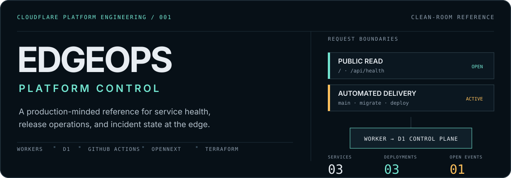
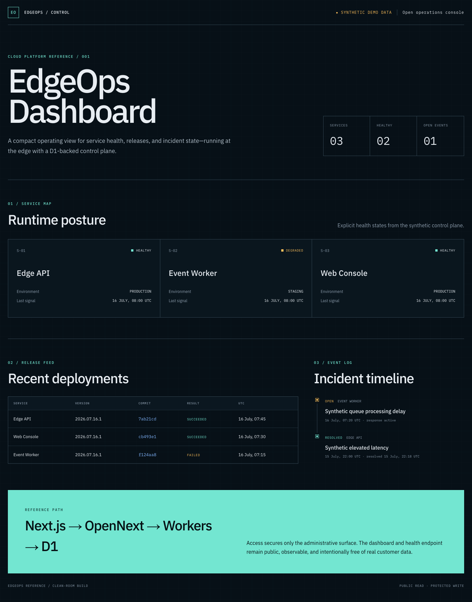
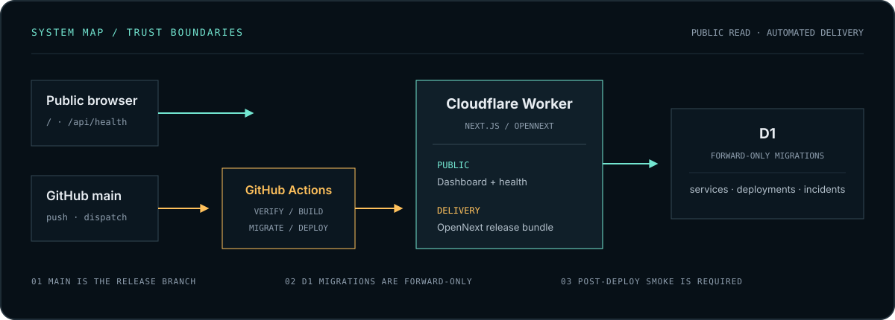

<p align="center">
  
</p>

<p align="center">
  <strong>A production-minded Cloudflare platform reference for service health, release operations, and incident state.</strong>
</p>

<p align="center">
  Next.js App Router · OpenNext · Workers · D1 · Terraform · GitHub Actions · Playwright
</p>

<p align="center">
  <a href="https://github.com/allensux01/cloudflare-edgeops-platform/actions/workflows/ci.yml"></a>
  <a href="https://github.com/allensux01/cloudflare-edgeops-platform/actions/workflows/deploy.yml"></a>
  <a href="https://edgeops-dashboard.allensux.workers.dev"></a>
</p>

EdgeOps is an independently developed portfolio project that makes the operational path visible: public service health, release history, incident state, typed D1 persistence, safe failure states, and automated delivery from GitHub to Cloudflare. Every service, release, and incident shown here is synthetic.

> **Current scope:** the public live demo is intentionally read-only. The tested admin/JWT modules remain as reference code, but Cloudflare Access is not provisioned and the admin surface is not offered as a live feature.

## See it working

<p align="center">
  
</p>

The dashboard is not a static mock. It reads D1 through a typed repository, renders explicit empty and unavailable states, and keeps the public surface free of database, binding, customer, and identity details. The responsive layout is also captured in the [mobile view](./docs/images/edgeops-dashboard-mobile.png).

Open the [live EdgeOps dashboard](https://edgeops-dashboard.allensux.workers.dev) or inspect its [public health contract](https://edgeops-dashboard.allensux.workers.dev/api/health).

## What this proves

- **Platform operations:** service posture, deployment history, incident state, and explicit D1-backed health checks.
- **Automated delivery:** every push to `main` runs the full CI gate; only a successful run can build OpenNext, apply forward-only D1 migrations, deploy the Worker, and smoke-test production.
- **Safe application behavior:** typed repository boundaries, strict Zod schemas, generic errors, and server-generated timestamps.
- **Production readiness:** forward-only migrations, no-store health responses, structured allowlisted logs, rollback guidance, and redacted degraded states.
- **Verification:** Workers-targeted unit and integration tests, real Chromium workflows, type checking, linting, Terraform validation, secret scanning, and OpenNext builds.

## Runtime and delivery boundaries

<p align="center">
  
</p>

Visitors reach `/` and `/api/health` directly through the Worker. GitHub Actions forms a separate delivery path: it authenticates with least-privilege repository secrets, applies recorded D1 migrations, deploys the pre-built Worker, and verifies both public routes. Terraform owns only the protected D1 resource; Wrangler/OpenNext owns application releases.

The repository still contains a fail-closed Access/JWT guard and admin workflow tests as an implementation reference. No Access application, allowed identity, team domain, or audience is configured in the public environment, so those routes are not part of the live-demo contract.

## Operational contract

| Concern | Implementation | Failure behavior |
| --- | --- | --- |
| Service health | Public `GET /api/health` with a timed D1 probe | `503` with a redacted D1 status |
| Dashboard reads | Typed D1 repository over synthetic data | Explicit empty or redacted unavailable state |
| Admin reference | JWT guard has no production Access configuration | Fail closed with generic `401` |
| Database change | Forward-only, additive-first migrations | Forward-fix migration; no destructive auto-rollback |
| Observability | JSON logs with an allowlisted field type | No tokens, claims, bodies, emails, or resource IDs |
| Continuous delivery | Push to `main` → CI gate → build → migrate → deploy → smoke | Serialized deploys; failed CI stops release |

## Run it locally

Requirements: a current Node.js LTS release and npm.

```bash
npm ci
npm run d1:migrate:local
npm run dev
```

Then open `http://localhost:3000`.

The optional admin reference can be exercised locally only:

```bash
LOCAL_ACCESS_BYPASS=true npm run dev
```

The guard ignores this bypass in production. Start from [`.env.example`](./.env.example) or [`.dev.vars.example`](./.dev.vars.example); local copies, credentials, Terraform state, and Cloudflare account metadata are excluded from Git.

## Verify the same paths

```bash
npm run typecheck
npm run lint
npm test
npm run test:e2e
npm run test:e2e:protected
npm run build:worker
```

Vitest covers migration replay, repository behavior, D1 failure health, the optional JWT guard, validation, idempotency, and incident transitions. Playwright drives the public dashboard and isolated reference workflows in Chromium.

## Repository map

```text
src/app/             Next.js routes and public dashboard
src/lib/auth/        Optional fail-closed JWT reference
src/lib/api/         Reference API orchestration and safe error contracts
src/lib/db/          Typed D1 repository and state transitions
migrations/          Separate schema and synthetic seed migrations
test/                Workers tests and Playwright browser workflows
docs/                Design, acceptance, provenance, and runbooks
```

## Deliberate limits

The first public version stays small enough to audit. It does not offer a live admin console, Cloudflare Access, multi-tenancy, complex RBAC, notifications, queues, email, Kanban, or destructive database rollback. Terraform uses local state, the demo has no SLA, and scheduled checks report through GitHub Actions rather than a paging service.

## Engineering record

- [Architecture and design](./docs/plans/2026-07-16-cloudflare-platform-reference-design.md)
- [Implementation plan](./docs/plans/2026-07-16-cloudflare-platform-reference-implementation.md)
- [Acceptance criteria](./docs/acceptance-criteria.md)
- [Clean-room provenance](./docs/provenance.md)
- [Publication checklist](./docs/publication-checklist.md)
- [Deploy and rollback runbook](./docs/runbooks/deploy-and-rollback.md)

## License

[MIT](./LICENSE) — built as a clean-room reference with synthetic data and no employer source code, production configuration, or customer information.
